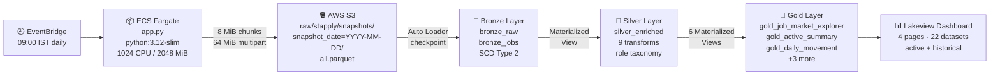
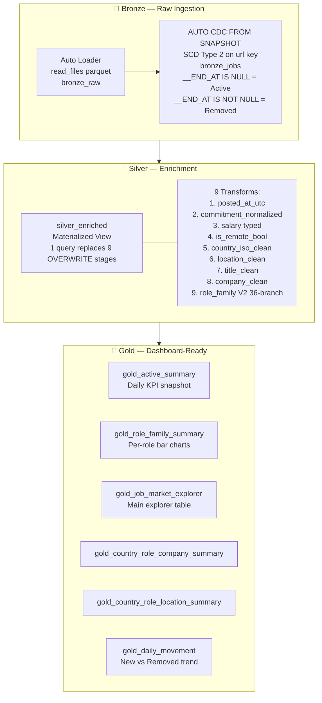
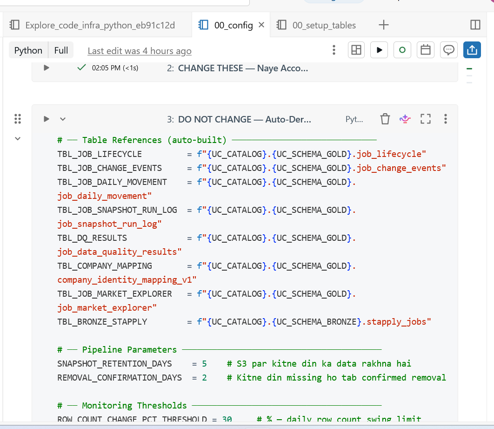
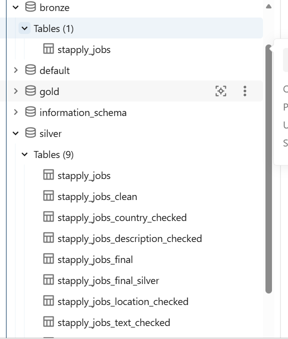

<div align="center">

# 🚀 Top ATS Platform Jobs
### Stapply Job Market — Enterprise Data Engineering Pipeline

[](https://aws.amazon.com/fargate/)
[](https://www.databricks.com/)
[](https://delta.io/)
[](https://python.org)
[](https://docker.com)
[](https://docs.databricks.com/data-governance/unity-catalog/)

**A production-grade, serverless lakehouse pipeline tracking 400K+ job postings across 8 ATS platforms — daily, automatically, with full lifecycle history.**

</div>

---

## 🎯 Business Problem

> **ATS job feeds are point-in-time snapshots. Every API call overwrites the last one.**

Hiring platforms like Greenhouse, Lever, and Ashby expose live job feeds — but they have **no history**. When you query them today, yesterday's data is gone. This creates three real gaps:

| Gap | Business Impact |
|-----|----------------|
| ❌ No lifecycle tracking | Can't tell if a job was posted for 3 days or 3 months |
| ❌ No removal detection | Can't distinguish "filled" from "paused" from "expired" |
| ❌ No cross-ATS standardization | Each platform uses different field names, salary formats, country codes |

**This pipeline solves all three** — turning ephemeral ATS snapshots into a permanent, enriched, queryable job market history.

---

## 📐 End-to-End Architecture



---

## 🔄 Medallion Pipeline — Bronze → Silver → Gold



---

## 📊 Key Metrics

| Metric | Value |
|--------|-------|
| 📋 ATS Platforms Covered | Greenhouse · Lever · Ashby · Workday + 4 more |
| 📦 Daily Snapshot Size | ~8 MiB Parquet (Snappy compressed) |
| 🥉 Bronze Tables | 2 (raw + SCD Type 2 history) |
| 🥈 Silver Views | 1 Materialized View (9 transforms) |
| 🥇 Gold Views | 6 Materialized Views |
| 📊 Dashboard | 4 pages · 22 datasets |
| ⏱️ Pipeline Runtime | ~8 min (Photon + Serverless) |
| 🔄 Schedule | Daily 09:00 IST (EventBridge) |
| 🌍 AWS Region | eu-north-1 (Stockholm) |
| 🏗️ Generations | Gen1 → Gen2 → Gen3 (3 rebuilds) |

---

## 🛠️ Tech Stack

| Layer | Technology | Why |
|-------|-----------|-----|
| **Scheduler** | AWS EventBridge | Cron-based, zero infra, IST timezone |
| **Compute (Scraper)** | AWS ECS Fargate | Serverless containers, no EC2 management |
| **Container** | Docker `python:3.12-slim` | Minimal attack surface, 1024 CPU / 2048 MiB |
| **Networking** | 0 NAT Gateways | VPC endpoint + public subnet (cost-optimized) |
| **Storage** | AWS S3 (Parquet + Snappy) | Columnar, partition-aware, Auto Loader compatible |
| **Ingestion** | Databricks Auto Loader | Checkpoint-based, exactly-once, schema evolution |
| **CDC** | Auto CDC FROM SNAPSHOT | Native SCD Type 2, no MERGE SQL needed |
| **Transform** | Databricks Materialized Views | Auto-refresh, built-in DQ expectations |
| **Governance** | Unity Catalog | Fine-grained access, lineage, tagging |
| **Execution** | Photon + Serverless | Vectorized engine, no cluster sizing |
| **Dashboard** | Databricks Lakeview | Native BI, 22 datasets, auto-refresh |

---

## 📸 Evidence Gallery

> All screenshots are from the live production deployment. Sensitive values (Account IDs, bucket names, emails) are redacted with solid fills.

---

### ⚙️ Configuration — `config.py`


> Central config: S3 path, catalog, schema, pipeline name, Photon, Serverless, alert emails — all in one file. Run `01_deploy.py` once and the entire pipeline is provisioned.

---

### 🪣 S3 Bucket — Hive-Partitioned Parquet Layout


> `snapshot_date=YYYY-MM-DD/all.parquet` — Hive partitioning lets Auto Loader process only new partitions on each run. Zero reprocessing of historical data.

---

### ✅ Successful Fargate Task Run


> ECS task exits with code 0. EventBridge fired at 09:00 IST, Fargate ran, Parquet uploaded to S3, task terminated — fully stateless.

---

### 🌐 ECS Cluster


> Fargate cluster — no EC2 instances to manage. Task spins up on schedule, runs, terminates.

---

### 📋 ECS Task Definition


> 1024 CPU / 2048 MiB, `eu-north-1`, environment variables injected (no hard-coded credentials in image).

---

### 🕘 EventBridge Scheduler


> `cron(30 3 * * ? *)` UTC = 09:00 IST. Triggers ECS Fargate task. Zero manual intervention.

---

### 🔒 Networking & VPC


> 0 NAT Gateways. VPC endpoint for S3 + public subnet. Saves ~$32/month vs standard NAT setup.

---

### 🥉 Bronze Table (SCD Type 2)


> `bronze_jobs` — SCD Type 2. `__END_AT IS NULL` = job is live. `__END_AT IS NOT NULL` = job removed from ATS feed. Every job ever seen is preserved forever.

---

### 📸 Successful Snapshot Ingestion


> Auto Loader checkpoint confirms new partition landed. Pipeline processes only the delta — no full re-scan.

---

### 🏃 Successful Job Run


> All pipeline tasks completed. Green across the board.

---

### 📋 Task Run Log


> Per-task execution log. Duration, status, row counts — all visible for debugging.

---

### 🔄 Updated Run Log


> Run history — daily automated executions tracked.

---

### 🌊 SDP Pipeline — Live View


> Streaming Delta Pipeline UI — bronze → silver → gold flow visible in real time. 414K rows in silver (expected — SCD Type 2 includes full history).

---

### 🥇 Gold Tables


> 6 Gold Materialized Views registered in Unity Catalog. Auto-refresh on every pipeline update.

---

### 📊 Dashboard — Page 1 (Job Market Overview)


> Active job counts, ATS distribution, remote %, fresh job %. Filters: country, role family, company.

---

### 📊 Dashboard — Page 2


> Salary distribution by role family and country.

---

### 📊 Dashboard — Page 3


> Job age buckets: Fresh (0-7d) / Recent (8-30d) / Ageing (31-90d) / Older (>90d).

---

### 📊 Dashboard — Additional Views


---

### 🔍 Lifecycle Table (Gen2 Reference)


> Gen2 lifecycle table — `lifecycle_status`, `first_seen_date`, `missing_since_date`, `times_seen`. Superseded in Gen3 by SCD Type 2 natively.

---

### 🗃️ Workspace Project Tree


> `/Shared/stapply-deployment/` — config.py, SQL templates, notebooks, dashboard JSON. All deployed via `01_deploy.py`.

---

### 📋 Unity Catalog Tables


> All 9 SDP objects registered under `workspace.default.*` with lineage and governance.

---

## 📂 Code Structure

```
code/
├── aws-fargate/
│   ├── app.py              # ATS scraper + S3 Parquet writer
│   ├── Dockerfile          # python:3.12-slim
│   └── FLOW.md             # ← Flow diagram
│
└── databricks-sdp/
    ├── config.py           # Central config (edit this first)
    ├── transformations/
    │   ├── bronze/
    │   │   ├── bronze.sql  # Auto Loader + Auto CDC FROM SNAPSHOT
    │   │   └── FLOW.md     # ← Flow diagram
    │   ├── silver/
    │   │   ├── silver.sql  # 9 transforms + role taxonomy MV
    │   │   └── FLOW.md     # ← Flow diagram
    │   └── gold/
    │       ├── gold.sql    # 6 Materialized Views
    │       └── FLOW.md     # ← Flow diagram
    ├── notebooks/
    │   ├── 01_deploy.py    # One-click deployment
    │   ├── 02_handover_guide.py
    │   └── FLOW.md         # ← Flow diagram
    └── gen2-reference/
        └── sql/ddl/gold_tables.sql
```

---

## 📈 Architecture Evolution — Gen1 → Gen2 → Gen3

| Feature | Gen1 (Export) | Gen2 (Classic) | Gen3 (SDP) ✅ |
|---------|--------------|---------------|--------------|
| Orchestration | Databricks Job (4 tasks) | Databricks Job (7 tasks) | SDP Lakeflow (serverless) |
| Bronze | Manual snapshot copy | Auto Loader | Auto Loader + Auto CDC |
| CDC / History | MERGE + lifecycle Python | MERGE + lifecycle Python | **Auto CDC FROM SNAPSHOT (SCD Type 2)** |
| Silver | 9 separate OVERWRITE tables | 9 OVERWRITE tables | **1 Materialized View** |
| Gold | 7 tables | 30 tables | **6 Materialized Views** |
| DQ | Notebook-based (manual) | Notebook-based (manual) | **Built-in CONSTRAINT expectations** |
| Runtime | ~20 min | ~14-15 min | **~8 min** |
| Cluster | Manual sizing | Manual sizing | **Serverless + Photon** |
| Deploy | Manual notebook run | Manual notebook run | **One-click (01_deploy.py)** |

---

## 🚀 Quick Deploy (New Account)

> Full deployment guide → [`code/README.md`](code/README.md)

```bash
# 1. Build & push Fargate image
docker build -t stapply-scraper ./code/aws-fargate
aws ecr create-repository --repository-name stapply-scraper --region eu-north-1
docker push <ACCOUNT>.dkr.ecr.eu-north-1.amazonaws.com/stapply-scraper:latest

# 2. Create ECS Task → EventBridge rule (09:00 IST)

# 3. In Databricks — edit config.py, then Run All in 01_deploy.py
```

---

## 🔐 Security Notes

- ✅ Zero credentials in source code
- ✅ S3 bucket name, AWS Account ID, emails — all replaced with `<PLACEHOLDER>`
- ✅ ECS Task Definition injects `S3_BUCKET` at runtime via environment variables
- ✅ Databricks token injected by workspace context (no hard-coding)
- ✅ All screenshots with Account IDs / bucket names are opaque-redacted

---

## 👤 Author

**Rishikesh Yadav** — Data Engineer  
*AWS ECS · Databricks · Delta Lake · Unity Catalog · Python · SQL*

---

<div align="center">
<sub>Built with AWS ECS Fargate + Databricks Lakeflow SDP · eu-north-1 · Oct 2026</sub>
</div>
