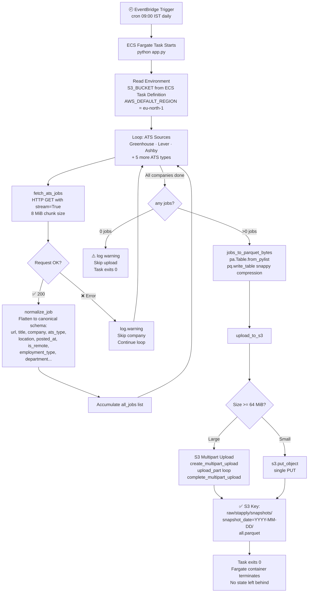
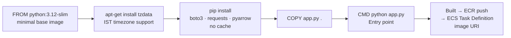

# AWS Fargate Scraper — Code Flow

## What This Does
Daily ATS job scraper running as a **serverless ECS Fargate container**.  
Triggered by EventBridge → streams job data from ATS APIs → writes Parquet to S3.

---

## `app.py` Flow Diagram

---

## `Dockerfile` Flow

---

## Key Design Decisions

| Decision | Why |
|----------|-----|
| `stream=True` with 8 MiB chunks | Avoids OOM on large ATS feeds |
| 64 MiB multipart threshold | S3 best practice for large uploads |
| Hive partition `snapshot_date=YYYY-MM-DD` | Auto Loader picks up only new dates |
| `python:3.12-slim` base | Minimal CVE surface; tzdata only extra dep |
| 0 NAT Gateways | VPC endpoint + public subnet saves ~$32/month |
| Stateless design | No DB, no queue — full S3 state → easy re-runs |
