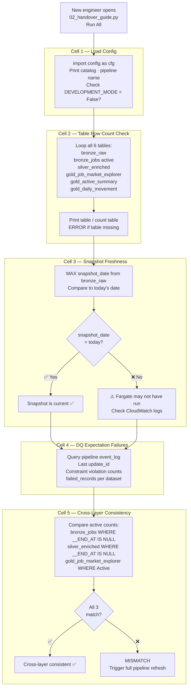

# Deployment Notebooks — Code Flow

## What This Does
Two notebooks that handle the **full lifecycle** of the pipeline:
- `01_deploy.py` — one-click deployment (provisions everything from scratch)
- `02_handover_guide.py` — health check + ops runbook for new engineers

---

## `01_deploy.py` — One-Click Deployment Flow

```mermaid
flowchart TD
    START["Engineer opens 01_deploy.py\nin Databricks workspace\nRun All"] --> C1

    subgraph CELL1 ["Cell 1 — Load Config"]
        C1["import config as cfg\nPrint: S3_PATH · CATALOG · SCHEMA\nPIPELINE_NAME · DEV_MODE · Serverless"]
    end

    C1 --> C2

    subgraph CELL2 ["Cell 2 — Render SQL Templates"]
        C2["render_sql function\nReads bronze.sql · silver.sql · gold.sql\nReplaces {{S3_PATH}} placeholder\nwith actual S3 path from config.py"]
        C2 --> C2B{"S3_PATH\ninjected?"}
        C2B -->|"✅ Yes"| C2C["SQL ready for upload"]
        C2B -->|"❌ No"| C2D["KeyError — fix config.py first"]
    end

    C2C --> C3

    subgraph CELL3 ["Cell 3 — Create SDP Pipeline via REST API"]
        C3["GET Databricks HOST + TOKEN\nfrom notebook context\nNo hard-coded credentials"]
        C3 --> C3B["POST /api/2.0/pipelines\nPayload:\n- name · serverless · photon\n- development mode\n- catalog · target schema\n- alert email recipients\n- SQL file library references"]
        C3B --> C3C["Store PIPELINE_ID\nPrint pipeline URL"]
    end

    C3C --> C4

    subgraph CELL4 ["Cell 4 — Upload SQL Files to Workspace"]
        C4["workspace/mkdirs\nCreate bronze/ silver/ gold/ folders"]
        C4 --> C4B["workspace/import\nBase64-encode each SQL file\nUpload bronze.sql · silver.sql · gold.sql\noverwrite=True"]
    end

    C4B --> C5

    subgraph CELL5 ["Cell 5 — Start Pipeline and Wait"]
        C5["POST /api/2.0/pipelines/PIPELINE_ID/updates\nfull_refresh: False"]
        C5 --> C5B["Poll loop every 30s\nMax 60 iterations = 30 min"]
        C5B --> C5C{State?}
        C5C -->|"COMPLETED"| C5D["✅ Continue"]
        C5C -->|"FAILED / CANCELED"| C5E["❌ Raise RuntimeError\nCheck pipeline event log"]
        C5C -->|"Running"| C5B
    end

    C5D --> C6

    subgraph CELL6 ["Cell 6 — Publish Dashboard"]
        C6["POST /api/2.0/lakeview/dashboards\nUpload dashboard_config.json"]
        C6 --> C6B["POST /published\nMake dashboard shareable"]
        C6B --> C6C["Store DASHBOARD_ID\nPrint dashboard URL"]
    end

    C6C --> C7

    subgraph CELL7 ["Cell 7 — Health Check"]
        C7["spark.sql COUNT queries:\nbronze_raw snapshots\nbronze_jobs active/total\nsilver_enriched rows\ngold_job_market_explorer rows"]
        C7 --> C7B{Cross-layer\nmatch?}
        C7B -->|"✅ All equal"| C7C["ALL LAYERS MATCH\nDone ✅"]
        C7B -->|"❌ Mismatch"| C7D["MISMATCH — trigger full refresh"]
    end
```

---

## `02_handover_guide.py` — Health Check Flow

---

## Key Design Decisions

| Decision | Why |
|----------|-----|
| Databricks context for HOST + TOKEN | Zero credential hard-coding |
| `render_sql` template function | Same SQL works across any S3 bucket — just edit config.py |
| Poll loop max 30 min | Prevents infinite hangs on pipeline failures |
| Health check as final cell | Deployment not "done" until data verified |
| Handover guide is self-contained | New engineer needs zero context from previous owner |
