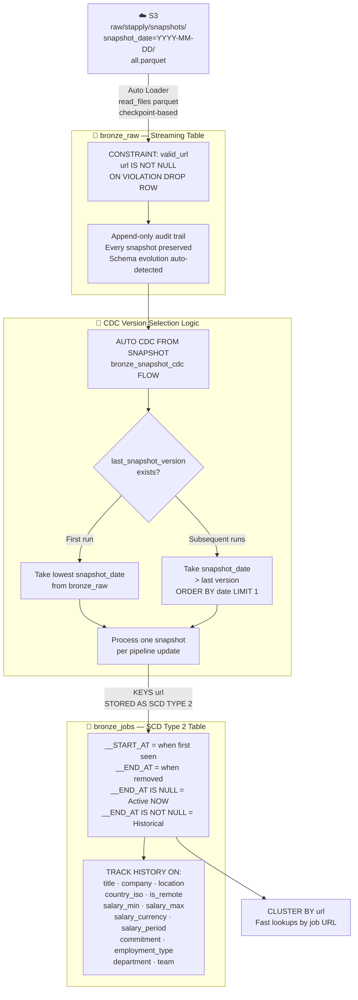
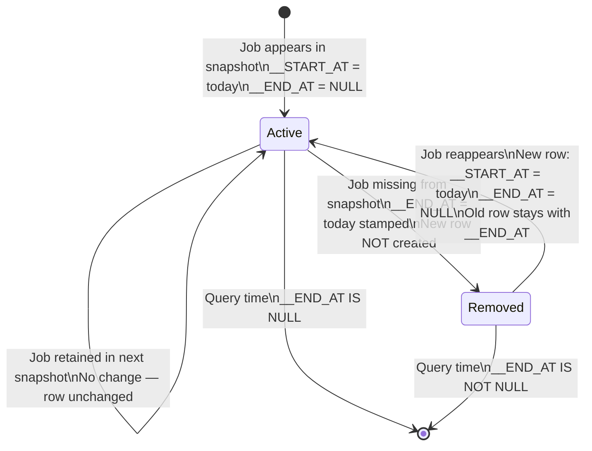

# Bronze Layer — Code Flow

## What This Does
Ingests daily Parquet snapshots from S3 into Delta Lake using **Auto Loader**,  
then tracks every job's full history using **Auto CDC FROM SNAPSHOT (SCD Type 2)**.

> **Key insight:** A job posting that disappears from the ATS feed is NOT deleted.  
> It gets `__END_AT` stamped. History is preserved forever.

---

## `bronze.sql` Flow Diagram

---

## SCD Type 2 State Machine

---

## Key Design Decisions

| Decision | Why |
|----------|-----|
| Auto Loader (not COPY INTO) | Checkpoint-based — exactly-once, no duplicate ingestion |
| SCD Type 2 (not OVERWRITE) | Full history preserved — can query any point in time |
| `LIMIT 1` per pipeline update | Processes one snapshot at a time — prevents version skips |
| `CONSTRAINT valid_url DROP ROW` | Rejects malformed rows at ingest — doesn't fail the pipeline |
| `CLUSTER BY (url)` | Optimizes SCD2 lookup performance on the primary key |
