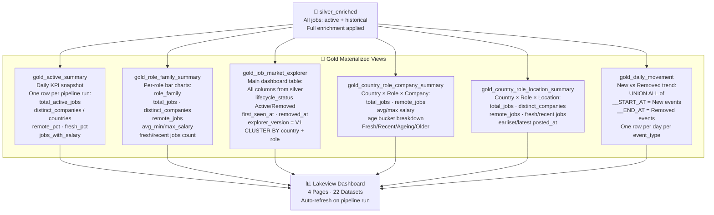
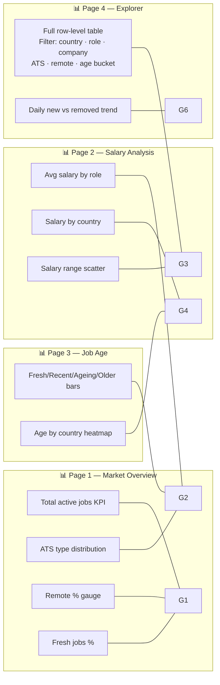
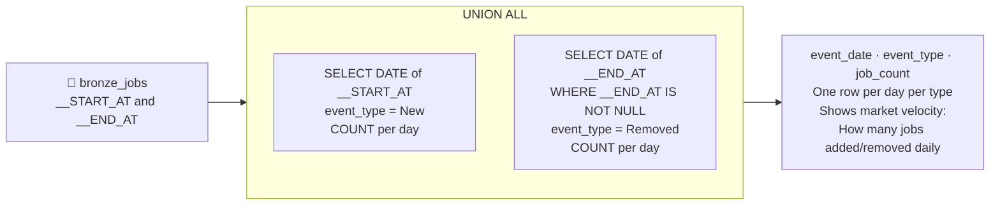

# Gold Layer — Code Flow

## What This Does
Six **Materialized Views** built on `silver_enriched`.  
Dashboard-ready. Auto-refresh on every Silver update. Zero ETL jobs needed.

---

## `gold.sql` — All 6 Views Flow

---

## Dashboard Mapping

---

## `gold_daily_movement` — SCD2 Lifecycle Analytics

---

## Key Design Decisions

| Decision | Why |
|----------|-----|
| Materialized Views (not tables) | Auto-refresh — no CRON job needed to rebuild Gold |
| All views filter `__END_AT IS NULL` where relevant | Active-only metrics for KPI views |
| `gold_job_market_explorer` keeps full history | Explorer lets analysts filter Active vs Removed |
| `CLUSTER BY (country_iso_clean, role_family)` | Optimizes dashboard geo + role filter queries |
| `gold_daily_movement` uses UNION ALL | Avoids complex window functions — readable and fast |
