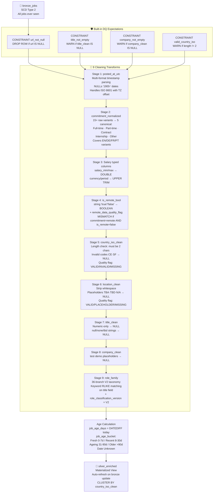
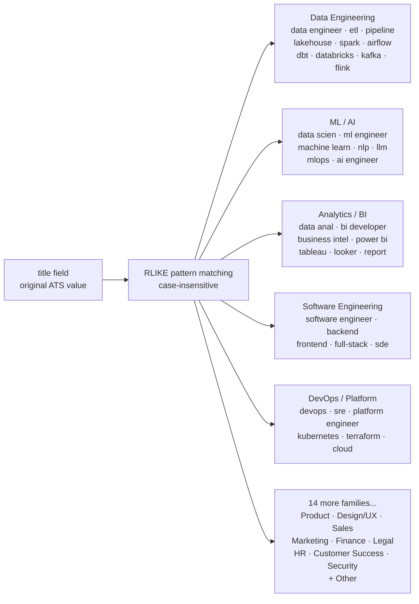

# Silver Layer — Code Flow

## What This Does
One **Materialized View** that replaces 9 separate OVERWRITE tables from Gen2.  
Applies 9 cleaning transforms + 36-branch role taxonomy + built-in DQ expectations.  
Auto-refreshes when `bronze_jobs` updates — zero manual triggers.

---

## `silver.sql` Flow Diagram

---

## Role Family Taxonomy (36-branch V2)

---

## Gen2 vs Gen3 Comparison

| | Gen2 (9 OVERWRITE tables) | Gen3 (1 Materialized View) ✅ |
|--|--------------------------|-------------------------------|
| **Code lines** | ~400 (9 separate CREATE TABLE) | ~180 (1 MV query) |
| **Refresh** | Manual trigger per stage | Auto-refresh |
| **DQ** | Separate notebook | Built-in CONSTRAINT |
| **Consistency** | Risk of partial failure | Atomic MV refresh |
| **Runtime** | ~8 min Silver stage | Merged into pipeline |
